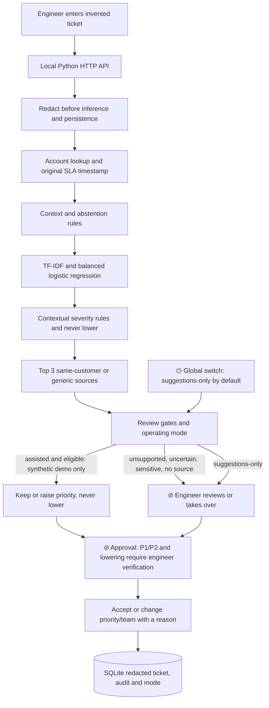

# 04 Architecture of the SLA triage copilot

**Updated 23 November 2026 | Actual evaluated engine v0.5 | Local synthetic-data prototype**

The console is a fixed internal triage workflow, not an autonomous tool-choosing agent. A classical classifier proposes severity; explicit rules, retrieval and human checkpoints bound the result. [Recorded evaluations](evals/report_v0.md) fail the launch criteria, so [the release decision](08_launch_memo.md) is no live assisted launch.

## Workflow and human checkpoints

Human checkpoints (the course's person marker): abstention for insufficient or unsupported input; approval for P1/P2 and lowering; human-only privileged/legal handling; manual takeover. The global switch is the course's override marker. Suggested production sampling of routine tickets remains a future policy, not an implemented sampling service.

## Components

| Component | Rung and pattern | Trust and checkpoint | Evidence or metric |
|---|---|---|---|
| Redaction | Rung 1 rules, fixed preprocessing | Automatic best-effort masking, not certified DLP | Recognised-pattern regression checks |
| Account/SLA lookup | Rung 1 deterministic lookup | Known synthetic account; unverified fallback for unknown account | Deadline remains anchored to creation time |
| Severity | Rung 2 classical classification plus rung 1 contextual rules | Suggestions for an engineer; rules and abstentions use ticket excerpts | Latest P1 recall 9/14; severity accuracy 36/50 |
| Retrieval | Rung 2 TF-IDF cosine, fixed index | Suggestion only; customer filter, minimum 0.08, top 3 | Candidate source hit 22/37; human relevance still required |
| Human policy | Rung 1 gates | Approval, abstention, takeover and persistent mode switch | Handover agreement 47/50; never-lower 50/50 |
| Console/API/audit | HTML/JS, Python standard-library ThreadingHTTPServer, SQLite | Local self-declared operator is not authentication | API/browser checks, persistence and audited corrections |

No LLM, external inference API, production ticketing connector or remediation endpoint is used. The model cannot select tools or run a planning loop. A more complex agent is not justified by the current bounded workflow.

## Scores and priority policy

Training uses TF-IDF unigrams/bigrams and balanced logistic regression, C=4, seed 17. A score is uncalibrated and does not mean the decision is correct that percentage of the time. Rule decisions have their own evidence. The calm/test-context cap can choose a non-P1 class; the console associates the displayed score with that scored class, rather than the initial class before the cap.

In **suggestions-only**, new tickets keep their declared priority. In the v0.5 **assisted demonstration**, an eligible higher proposal raises the priority even below classifier score 0.70; low score adds a human-review reason. Abstention and privileged-change gates prevent such a raise; a separately matched critical rule can preserve incident urgency despite a legal question. All P1/P2 and any lowering still need engineer verification before acceptance. No current policy authorises this assisted mode on live tickets.

P1=60 and P2=240 minutes come from the scenario. P3=1,440 and P4=4,320 are explicit demo choices. A change never restarts the clock. No automatic customer message, permissions change, containment or ticket closure occurs.

## Fallbacks

- Unknown account, unsupported language or insufficient detail: abstain, preserve declared priority and require a person; an unknown account's displayed clock is provisional.
- Vague, attachment-only, legal, foreign-customer-data or unverified privileged requests: contextual abstention where recognised; exact wording coverage is incomplete.
- Low classifier score: show the review reason; it does not by itself block an assisted-mode raise in v0.5.
- No relevant source: do not invent a procedure; engineer review. Lexical retrieval may still return an irrelevant document, so non-empty results are not proof of relevance.
- Model error: API returns 503 and manual-triage instructions without creating a partial ticket. API unreachable: the console shows a connection error; no production ticket system is integrated.

## Stop switch and ownership

Default mode is suggestions-only. Header -> Change mode -> reason -> `POST /api/switch` persists the setting and operator/reason/time. It applies to new tickets and does not undo existing raised priorities or engineer decisions. Suggestions mode requires recorded verification before accepting existing tickets.

Proposed owner: Head of Support by day, on-call support engineer by night. Local operator names are self-declared. A seven-check team drill was recorded on 22 November 2026 at 01:20 UTC+01:00 by Malek Saoudi; the switch took 0.003 seconds in that local test. [Original evidence](evals/switch_drills/drill_2026-11-22_012010.json). This is not a measured operational response time from alert to rollback. Current verification is in [engineering_checks.md](evals/engineering_checks.md).

## Data, storage and evaluation

| Data | Actual state |
|---|---|
| Training | 300 synthetic rows, 70/75/90/65 by P1/P2/P3/P4; 40 template families; human label review pending |
| Knowledge base | 15 synthetic generic/customer documents; reuse approval is explicitly simulated |
| Demonstrations | Six UI fixtures and 20 original exposed examples, excluded from independent evaluation |
| Reviewed evaluations | 100 cases in `eval_set_v1.csv`, evaluated as two separate 50-case batches with different engine versions |
| Additional candidates | E101-E200 in `eval_set_v2_candidates.csv`, unlabelled and unpredicted; human overlap review required |
| Runtime | Git-ignored `prototype/runtime/triage.sqlite3`, redacted text, decisions and audit until reset |
| Frozen evidence | Cases/outputs/manifests/grades under `evals/runs`; original files preserved during finalisation |

Evaluation data is never loaded by training or interactive inference. New references must be reviewed before freeze and prediction. Existing exposed cases cannot establish generalisation of a model tuned on them. The second recorded batch was new but not fully blind because the developer had seen its inputs; main grading used LLM-prefilled sheets. The report retains these limits.

The finalisation tooling checks the original hashes and recomputes recorded metrics without predictions or overwriting evidence. Historical LF/CRLF-only conversion is supported; any other content change remains blocked. [Final brief](product_brief.md) | [Launch decision](08_launch_memo.md).
