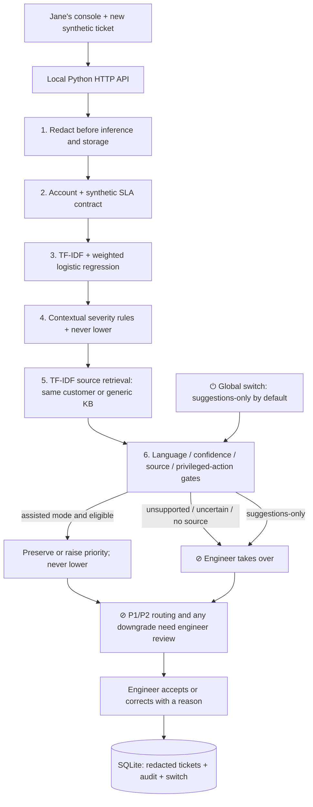

# 04 — Architecture · SLA-aware triage copilot · v0.4

**Assignment 4 · updated 15 November 2026 · local synthetic-data prototype.**
Implementation: `prototype/engine.py`, `server.py`, `store.py`, `console.js`.
Product evaluation is **pending human annotation and grading**, not passed.

## 1. One-line description
An internal console classifies a new support ticket, preserves or raises its effective priority under an explicit policy, looks up its SLA and retrieves reusable evidence for an engineer. It never sends a customer message or executes a remediation.

## 2. Diagram

## 3. Components
| Component | Rung / pattern | Trust / checkpoint | Observed or planned measure |
|---|---|---|---|
| Redaction | Rules / fixed chain | Local automatic preprocessing; best-effort regex, not certified DLP | Engineering redaction regression checks |
| Account and SLA lookup | Rules / lookup | L4 for known synthetic accounts; unknown account abstains | Deadline anchored to original creation timestamp |
| Severity classifier | Classical ML / routing | TF-IDF unigrams+bigrams + class-weighted logistic regression; seed 17 | Severity accuracy and P1 recall after human labels |
| Safety overlay | Rules / gate | Assisted mode may raise; no automatic downgrade; exact matched ticket excerpt | Never-lower and contextual-rule checks |
| Retrieval | TF-IDF cosine / fixed retrieval | L1; bilingual search aliases, minimum similarity 0.08; top 3; account filter before return | Human relevance judgement; source ids in outputs |
| Human policy gate | Rules / abstention + approval | Unsupported language/account, low score, legal/privileged requests and missing sources need review; all P1/P2 reviewed | Handover behaviour; counter-metric false P1 |
| Engineer UI + persistence | HTML/JS + local HTTP + SQLite | Named demo operator; reason for change; review before acceptance when required | Browser/API persistence and audit checks |

No calibrated confidence probability is claimed. `classifier_score` belongs to `classifier_severity`; a rule override has its own evidence and does not transform that score into a probability of the final severity. Threshold 0.70 is a provisional design choice, not an evaluated guarantee. Below it, the classifier's suggestion remains visible for review but is not automatically applied. Separately matched P1 safety rules and bounded P2/P3 service-impact rules can raise in assisted mode. They always retain the never-lower invariant.

The development safety policy includes a possible breach even if the same ticket also asks a legal question. A large outbound-volume jump (>=10x, >=50 GB final volume, comparable units) is a **possible incident**, not proof of data theft. Explicit hypothetical or planned-backup context does not alone trigger that rule. These thresholds and regex context handling are provisional, with known language/phrasing gaps; the independent evaluation is still required. Legal handling stays human-only and privileged-change requests cannot automatically raise through this exception.

## 4. Workflow or agent?
A fixed workflow: the code chooses the stages in advance. The model never selects tools or loops. This matches the bounded triage task and makes failure and takeover points explicit. There is no LLM, external inference API, fine-tuning or agent framework in v0.4. The HTML v0.2 original is retained as `prototype/prototype_triage_copilot_v0.2.html`.

## 5. Fallbacks
- No reusable source: no invented troubleshooting; show no source and require human review.
- Classifier score below 0.70: no model-driven auto-raise; record a human-review reason if no contextual rule matched. Separately matched policy rules may still raise in assisted mode.
- Unknown account or language other than EN/FR: abstain; retain declared priority. An unknown account's displayed fallback SLA is explicitly provisional.
- Privileged change / legal question: human-only handling; no access modification or legal answer.
- Model failure: API returns 503 with manual-triage instructions; no partially created ticket or priority change.
- API unreachable: the UI shows a connection error; the real ticketing system remains outside this prototype.

## 6. Override switch ⏻
- Target operational owner: Head of Support. **This is a role assignment in the design, not evidence of a real appointment.**
- Implementation: header → Change mode → reason → `POST /api/switch`.
- Default: `suggestions`. `assisted` is a deliberate opt-in for new tickets.
- Scope: all new tickets. Existing raised priorities and human decisions are preserved; switching off must not downgrade them. Acceptance of existing tickets in suggestions mode requires a recorded human review.
- Persistence: SQLite setting, with timestamp/operator/reason in audit.
- Local operator names are self-declared; no authentication or production authorisation is implemented. Bind loopback only.
- Engineering test evidence: see `evals/engineering_checks.md`. Team-operated acceptance test and sign-off: **pending**.

## 7. Data and leakage
| File | Purpose | Status |
|---|---|---|
| `prototype/data/training_tickets.csv` | 300 synthetic training rows: P1 70 / P2 75 / P3 90 / P4 65 | AI-proposed training labels, not human-reviewed; 40 template families; variants are not 300 independent incidents |
| `prototype/data/knowledge_base.json` | 15 synthetic resolved/KB documents | Versioned demo fixtures with explicitly simulated reuse sign-off, not real production incidents |
| `prototype/data/demo_tickets.json` | Six interactive demo inputs | Exposed during development; never a holdout |
| `evals/demo_reference_v0.csv` | Jane's original 20 examples | Exposed during design/review; excluded from independent evaluation; source text preserved |
| `evals/eval_set_v0.csv` | 50 new S4 candidate inputs in separate incident families | Expected answers deliberately blank; team must label before freeze/run |
| `prototype/runtime/triage.sqlite3` | Redacted local demo tickets, audit and switch | Git-ignored; delete the file while stopped to reset the demo |

No real customer data is used. Fixture provenance is synthetic authoring; no public dataset was downloaded. Do not represent proposed training labels, fixture reuse flags or AI-generated evaluation inputs as human-validated evidence. Family-id and exact-normalised-text overlap are checked mechanically; a human must also review semantic near-duplicates before freezing. Evaluation files are never loaded by the interactive engine or training code.

## 8. Eval result v0
**NOT YET EVALUATED.** The runner refuses unlabelled or unfrozen cases. `evals/report_v0.md` describes the protocol and pending human work. Engineering regression checks and browser verification are separate from the two-grader acceptance metric. No 62% achievement, 100% P1 recall, measured time saving or launch decision is claimed.

## 9. Next
Human-review training data and annotate the 50 holdout inputs. Freeze labels and model, run once, then have two people grade independently. Add each observed product miss to the spec before evaluating a later version on a fresh holdout.

## 10. Development correction and handoff — 15 November
The initial exposed-demo diagnostic is preserved. The [separate post-fix run](evals/ai_review/post_fix_2026_11_15/comparison.md) records 20/20 proposed severities, 17/20 routes and 20/20 candidate-source hits against provisional references; this is tuning evidence, not a passed holdout. Three ownership disagreements remain C09/C15/C17. Search aliases are metadata, never evidence of ticket facts. The engine does not import evaluation files.

[Team validation instructions](evals/VALIDATION_EQUIPE.md) cover actual label review, guarded import, freeze, two independent graders and switch sign-off. The import creates a separate reviewed CSV only after explicit human decision/name/date fields are filled; it does not invoke inference or create grades.
